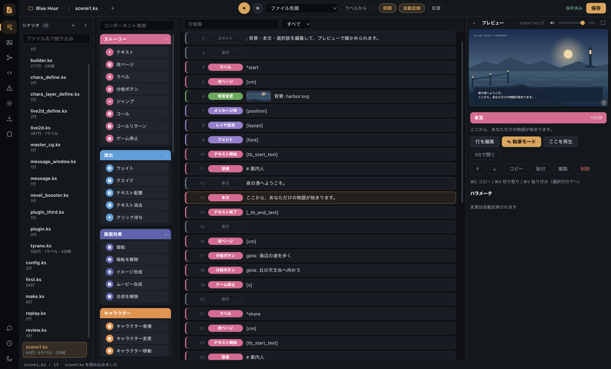
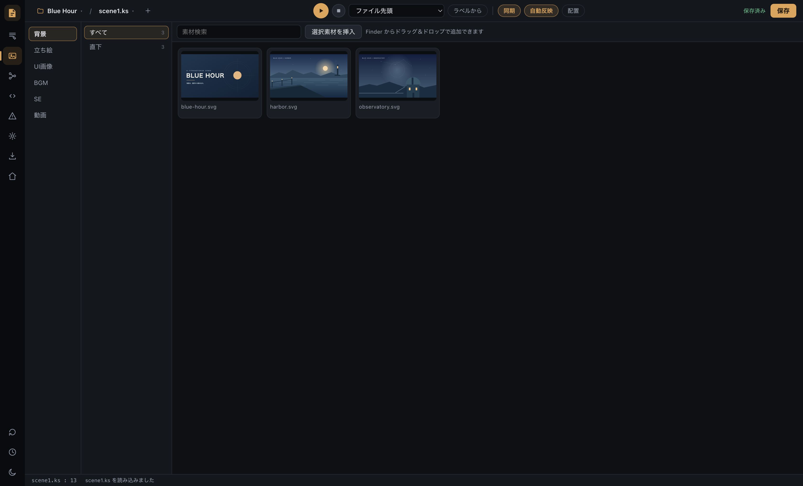
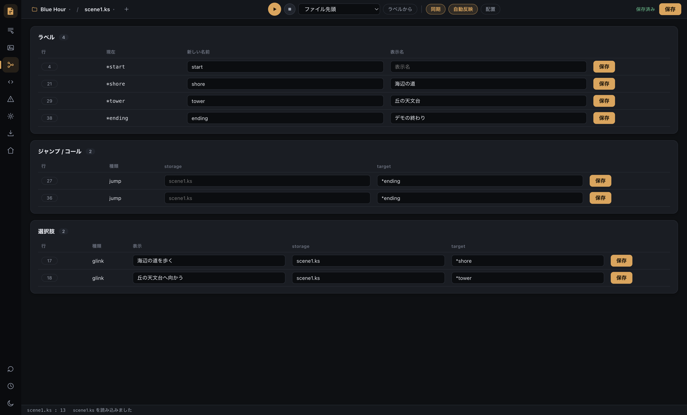
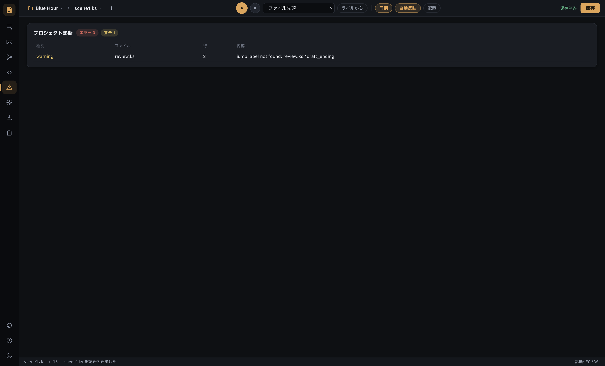
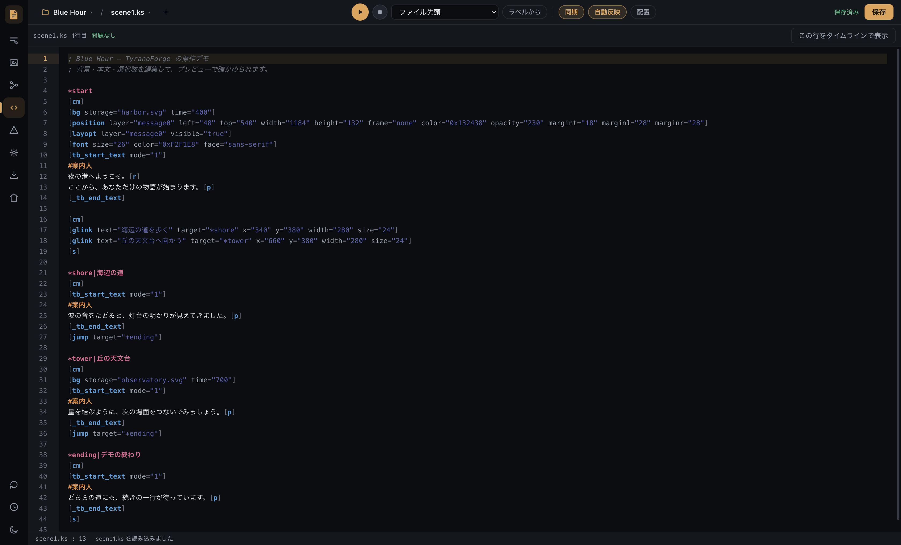
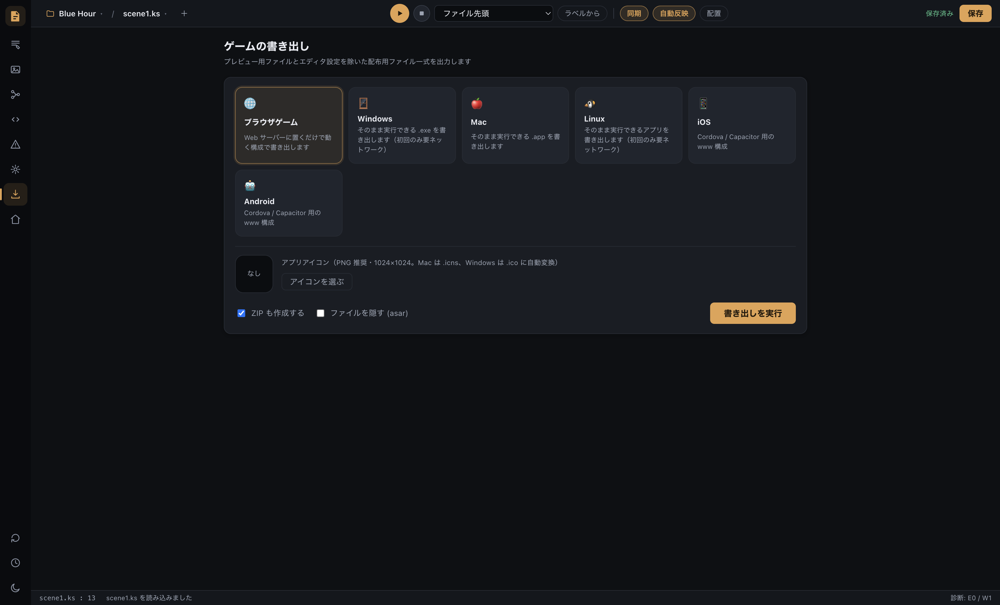

# TyranoForge

TyranoBuilder / TyranoScript のプロジェクトをそのまま開いて編集できる、ビジュアルノベル制作アプリです。文章を書き、素材や演出を組み合わせ、その場で再生して確かめられます。

## ダウンロード

| お使いのパソコン | ダウンロード |
|---|---|
| Windows（64ビット） | [Windows 版をダウンロード](https://github.com/skyt-a/tyrano-forge/releases/latest/download/TyranoForge-Windows-x64.zip) |
| Mac（Apple Silicon / M1 以降、macOS 12 以上） | [Mac 版をダウンロード](https://github.com/skyt-a/tyrano-forge/releases/latest/download/TyranoForge-macOS-arm64.zip) |

[リリース一覧・更新内容](https://github.com/skyt-a/tyrano-forge/releases)

ZIP を展開して使えます。Node.js のインストールやコマンド操作は不要です。

## 使い始める

1. ダウンロードした ZIP を展開します。Windows は展開したフォルダー内の `TyranoForge.exe`、Mac は「アプリケーション」へ移した `TyranoForge.app` を開きます。
2. 編集するプロジェクトを開きます。既存のプロジェクトを自動で見つけられない場合は、フォルダーを選ぶ画面が表示されます。
3. 左側の一覧からシナリオを選び、文章や演出を編集します。上部の ▶ ボタンで、編集した場面を再生できます。

TyranoBuilder または TyranoScript で作成したプロジェクトをご用意ください。新規プロジェクトの作成には、TyranoBuilder のインストールが必要です。

Mac で起動が止められる場合は、[Apple の案内](https://support.apple.com/ja-jp/102445)を参照してください。

## できること

- **文章・演出の編集** — テキスト、背景、立ち絵、音楽、選択肢などを並べて場面を作れます。
- **その場でプレビュー** — 先頭や選んだ行から再生し、見た目や会話の流れを確認できます。立ち絵は画面上で配置を調整できます。
- **素材の管理** — 背景・立ち絵・音声・動画を一覧で確認し、ドラッグ＆ドロップで追加できます。
- **分岐の整理** — 選択肢や移動先を一覧で編集できます。ラベル名の変更は参照先にも反映されます。
- **シナリオの直接編集** — KS 本文を開いて、検索やタグ補完を使いながら編集できます。
- **見落としの確認** — 素材の不足や移動先の指定漏れを診断できます。

<table>
  <tr>
    <td width="33%"> 素材を探す</td>
    <td width="33%"> 分岐を整理する</td>
    <td width="33%"> 見落としを確認する</td>
  </tr>
</table>

## 保存とプロジェクトの互換性

編集は自動保存され、保存履歴から以前の内容へ戻せます。前回開いていたプロジェクトやシナリオは、次回起動時に復元されます。

TyranoBuilder と同じプロジェクトを行き来しながら使えます。既存のタグやコメントを保ったまま編集でき、独自のプラグインを使ったプロジェクトも開けます。一部の拡張機能には専用の編集画面がありません。

## ゲームの書き出し

完成したゲームは、ブラウザ向けや Windows・Mac・Linux 向けに書き出せます。iOS・Android のアプリ化に使うファイルも出力できます（アプリ化には別途開発環境が必要です）。アプリアイコンや ZIP の作成も、書き出し画面で設定できます。

## よく使うショートカット

Windows は Ctrl、Mac は ⌘ を使います。

| 操作 | キー |
|---|---|
| 保存 | Ctrl / ⌘ + S |
| シナリオを探す | Ctrl / ⌘ + P |
| 画面の切り替え | Ctrl / ⌘ + 1〜8 |
| 行の移動・選択 | ↑ / ↓、Shift + クリック |

---

TyranoForge は非公式のコミュニティツールです。TyranoScript / TyranoBuilder の開発元とは無関係です。

[開発・ソースからの起動](docs/DEVELOPMENT.md) · [セキュリティ](SECURITY.md) · [MIT License](LICENSE) · [依存ライブラリのライセンス](THIRD_PARTY_NOTICES.md)
